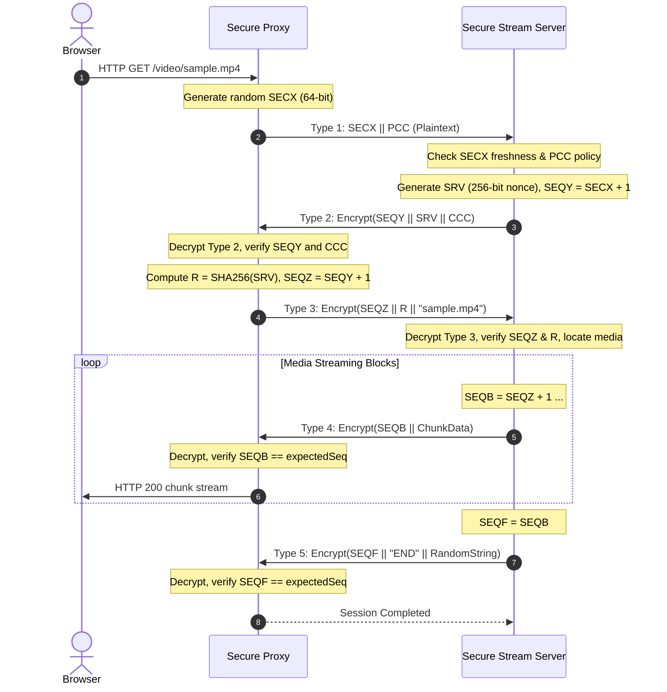

# 3S – Secure Streaming Solution: PART I
## Design, Implementation, and Experimental Evaluation of a Security Solution for Real-Time Media Streaming using Flexible Cryptographic Configurations

**Authors:**  
Nelson Martins (Nº 73954) &mdash; `n.martins@campus.fct.unl.pt`  
Ricardo Ferreira (Nº 77152) &mdash; `r.ferreira@campus.fct.unl.pt`  
*Department of Computer Science, NOVA School of Science and Technology (FCT NOVA)*  
*Computer Systems Security (SSC) — 2026/2027*

---

### Abstract
This technical report presents the architectural design, formal protocol specification, security implementation, and experimental evaluation of **3S (Secure Streaming Service)**, developed for Work Assignment 1 of Computer Systems Security. Starting from an insecure baseline architecture using raw sockets for MPEG-4 media streaming, we designed an application-layer secure streaming protocol that guarantees peer authentication, data confidentiality, message integrity, replay protection, and strict message ordering. The system features a fully externalized, configurable cryptographic engine supporting AEAD ciphers (AES-GCM, AES-CCM, ChaCha20-Poly1305, and RC6-GCM) as well as classic block/stream modes (CTR, CBC, ECB) combined with Encrypt-then-MAC (HMAC-SHA256, HMAC-SHA384, HMAC-SHA512). Through an automated validation testbench, we demonstrate that the solution mitigates all identified adversary threats (MITM tampering, replay, out-of-order injection, stream truncation) while maintaining high streaming throughput and zero data corruption across concurrent sessions.

**Keywords:** Secure Streaming Protocol, Applied Cryptography, Block Ciphers, Stream Ciphers, AEAD, Encrypt-then-MAC, Replay Protection, Media Streaming.

---

## 1. Introduction
Modern real-time media streaming applications require robust cryptographic protections against eavesdropping, packet modification, session hijacking, and replay attacks. In distributed media architectures, an origin streaming server delivers segmented audio-visual content over untrusted network channels to client-side proxies, which in turn feed standard HTML5 video renderers.

The reference baseline system provided for this project implemented bare TCP socket transmission without any cryptographic guarantees:
1. Media data was transmitted in plaintext, leaving video streams vulnerable to passive eavesdropping.
2. Neither the Stream Server nor the Stream Proxy authenticated their peers, exposing the system to impersonation and unauthorized media consumption.
3. Transmitted packets lacked integrity tags or sequence enforcement, allowing malicious intermediaries to tamper with, reorder, inject, or drop video chunks undetected.

To eliminate these vulnerabilities, we developed **3S (Secure Streaming Service)**. 3S establishes an application-layer secure channel using a 3-way authenticated cryptographic handshake, followed by protected chunk transmission using configurable symmetric ciphers and message authentication schemes.

---

## 2. System Model and Architectural Design

The 3S architecture consists of three logical tiers:

```
+--------------------+            +---------------------+            +-----------------------+
|   Web Browser      |   HTTP     |    Secure Proxy     |  3S Secure |  Secure Stream Server |
|  (HTML5 <video>)   | <========> | (ProxySocketServer) | <========> |    (StreamServer)     |
+--------------------+            +---------------------+  Protocol  +-----------------------+
                                             |                                   |
                                   [proxycrypto.config]               [sservercrypto.config]
```

1. **Secure Stream Server (`StreamServer`):**  
   Responsible for hosting the media library (`media/`), validating client handshake proposals against local security policy (`sservercrypto.config`), challenging the connecting proxy, slicing media files into discrete blocks (1024 bytes), encrypting each block with authenticated metadata, and signaling stream termination. The server uses a thread pool (`Executors.newCachedThreadPool()`) to handle multiple concurrent proxy connections.

2. **Secure Proxy (`ProxySocketServer`):**  
   Acts as an intermediary between the browser and the origin server. It exposes a minimal HTTP/1.1 endpoint on port 8080 serving a video playback interface (`/`) and video stream handler (`/video/<file>`). Upon receiving a client request, the proxy initiates the 3S handshake with the Stream Server, negotiates cryptographic suites, verifies the server's challenge, decrypts media chunks in real time, verifies integrity tags and sequence numbers, and streams the decrypted payload directly to the browser.

3. **Common Cryptographic Subsystem (`common/`):**  
   - `CryptoConfig`: Parses XML configuration files, extracts key material (hexadecimal or Base64), and checks policy compatibility.
   - `CryptoService`: Core cryptographic engine leveraging the Java Cryptography Architecture (JCA) and BouncyCastle provider to perform AEAD and Encrypt-then-MAC operations.
   - `ProtocolMessage`: Serialization, framing, and typed encapsulation of 3S messages.

---

## 3. Threat Model and Security Countermeasures

### 3.1 Adversary Capabilities
We operate under the standard network adversary model (Dolev-Yao model), wherein the attacker controls the communication link between the Secure Proxy and the Secure Stream Server. The attacker can:
- Intercept and eavesdrop on all transmitted packets.
- Modify arbitrary bytes within messages (tampering).
- Replay previously captured messages or handshake frames.
- Reorder packets or inject fabricated messages.
- Drop packets or truncate the stream prematurely.

Endpoints (the proxy host and server host) are assumed to be uncompromised and trusted.

### 3.2 Security Countermeasures Mapping

| Threat / Attack Vector | Severity | Mitigating Mechanism in 3S | Verification Evidence |
|---|---|---|---|
| **Passive Eavesdropping** | High | Symmetric payload encryption using AES-256, ChaCha20, or RC6. | Ciphertext entropy validated; media unreadable on wire. |
| **Man-in-the-Middle Modification** | Critical | AEAD authentication tags (GCM/CCM/Poly1305) or Encrypt-then-MAC (HMAC-SHA256/384/512). | `AEADBadTagException` / `SecurityException` triggered upon single-bit alteration. |
| **Handshake Replay Attacks** | High | Proxy generates random 64-bit nonce `SECX`; Server maintains a thread-safe cache of seen nonces. | Server rejects replayed `SECX` with Type 255 error alert. |
| **Session Hijacking / Impersonation** | High | Server generates 256-bit cryptographic challenge `SRV`; Proxy must prove knowledge of shared secret and compute `R = SHA256(SRV)`. | Fake `R` rejected with Type 255 error alert. |
| **Stream Chunk Replay / Duplication** | High | Monotonically incrementing block sequence numbers (`SEQB = SEQZ + 1, ...`). | Duplicate sequence rejected by Proxy sequence check. |
| **Packet Dropping / Reordering** | High | Strict consecutive sequence checking (`expectedSeq == t4.seqb()`). | Sequence gaps trigger immediate connection termination and alert. |
| **Stream Truncation Attack** | Medium | End block (Type 5) encapsulates encrypted `SEQF == expectedSeq` and `"END"` marker. | Premature EOF or dropped trailing blocks detected before termination. |
| **Path Traversal / Resource Access** | Medium | Path normalization and root containment check (`file.startsWith(root)`). | Access outside `media/` denied with Type 255 alert. |

---

## 4. Specification of the Secure Streaming Protocol

All protocol frames share a common 9-byte plaintext header followed by a variable-length payload:

```
+--------------------+--------------------+-------------------+--------------------+------------------------+
| Version (2 Bytes)  | Release (2 Bytes)  | Type (1 Byte)     | Length (4 Bytes)   | Payload (Length Bytes) |
| 0x0001 (Short)     | 0x0001 (Short)     | 1, 2, 3, 4, 5, 255| Big-Endian Int     | Encrypted / Plaintext  |
+--------------------+--------------------+-------------------+--------------------+------------------------+
```

### 4.1 Handshake Sequence



### 4.2 Message Types and Formats
- **Type 1 (Proxy Proposal):**  
  Payload: `SECX (Long, 8B) || PCC (UTF-8 String)`. Sent in plaintext to initiate negotiation.
- **Type 2 (Server Challenge):**  
  Payload: `Encrypt(SEQY (Long) || SRV_len (Int) || SRV (32B) || CCC (UTF-8 String))`. Encrypted under negotiated key.
- **Type 3 (Proxy Request):**  
  Payload: `Encrypt(SEQZ (Long) || R_len (Int) || R (32B) || MediaName (UTF-8 String))`. Encrypted under negotiated key.
- **Type 4 (Stream Block):**  
  Payload: `Encrypt(SEQB (Long) || BlockLen (Int) || MediaChunk (Bytes))`. Encrypted and authenticated per block.
- **Type 5 (Stream End):**  
  Payload: `Encrypt(SEQF (Long) || "END" (UTF) || RandomString (UTF))`.
- **Type 255 (Error Alert):**  
  Payload: `ErrorMessage (UTF-8 String)`. Sent whenever any protocol or cryptographic anomaly is detected.

---

## 5. Cryptographic Configuration System

The cryptographic subsystem avoids hardcoded algorithms, keys, or initialization vectors. Parameters are loaded from XML configuration files conforming to the project specification:

```xml
<?xml version="1.0" encoding="UTF-8"?>
<ProxyCryptoConfig version="1.0">
    <SymCipherSuite>
        <Algorithm>AES</Algorithm>         <!-- AES / ChaCha20 / RC6 -->
        <Mode>GCM</Mode>                   <!-- GCM / CCM / CTR / CBC / ECB / Poly1305 -->
        <InitializationVector>
            <IV>NULL</IV>                  <!-- Hex / Base64 / NULL -->
            <IVSize>96</IVSize>            <!-- 96 / 128 bits -->
        </InitializationVector>
        <Padding>NULL</Padding>            <!-- PKCS5Padding / NoPadding / NULL -->
    </SymCipherSuite>
    <MACSuite>
        <Algorithm>NULL</Algorithm>        <!-- HMAC-SHA256 / HMAC-SHA384 / HMAC-SHA512 / NULL -->
    </MACSuite>
    <ConfiguredKeys>
        <SymmetricKey>
            <SKey>000102030405060708090a0b0c0d0e0f101112131415161718191a1b1c1d1e1f</SKey>
            <KeySize>256</KeySize>
        </SymmetricKey>
        <MACKey>
            <MacKey>NULL</MacKey>
            <MacKeySize>NULL</MacKeySize>
        </MACKey>
    </ConfiguredKeys>
</ProxyCryptoConfig>
```

### Key Engineering Features:
1. **AEAD and Classic Dual Engine:**  
   When using AEAD modes (`AES-GCM`, `AES-CCM`, `ChaCha20-Poly1305`, `RC6-GCM`), the cipher provides confidentiality and integrity in a single cryptographic primitive; MAC configuration is defined as `NULL`. For classic modes (`CTR`, `CBC`, `ECB`), the engine implements **Encrypt-then-MAC** over `IV || Ciphertext` using constant-time digest verification (`MessageDigest.isEqual`).
2. **Fresh Nonce / IV Generation:**  
   To prevent catastrophic keystream reuse (e.g. in CTR or GCM modes), `CryptoService` generates a cryptographically secure random nonce/IV for each individual message and prepends it to the transmitted ciphertext.
3. **Encoding Flexibility:**  
   Supports both hexadecimal and Base64 representations for symmetric keys and MAC keys.

---

## 6. Implementation of the Secure Components

### 6.1 Secure Proxy (`streamproxy/ProxySocketServer.java`)
- **Web UI & Streaming Endpoint:** Serves a modern HTML5 player interface on `/` and handles streaming requests on `/video/<file>`.
- **Integrity Validation Pipeline:** Decrypts incoming Type 4 frames. If an AEAD tag mismatch or invalid HMAC occurs, it logs an alert and transmits a Type 255 Error Alert to the server.
- **Sequence Verification:** Rejects missing, duplicate, or reordered frames.
- **Real-Time Instrumentation:** Collects metrics including blocks received, blocks forwarded, processing throughput (kB/s and MB/s), and total volume processed.

### 6.2 Secure Stream Server (`streamserver/StreamServer.java`)
- **Non-blocking Concurrency:** Implements a cached thread pool to service multiple proxy instances simultaneously.
- **Replay Protection Table:** Maintains a thread-safe cache (`ConcurrentHashMap.newKeySet()`) of all received `SECX` nonces to reject replayed Type 1 handshake initiations.
- **Path Sanitization:** Resolves requested filenames relative to the authorized media root, preventing directory traversal attacks.
- **Chunked Slicing:** Streams media in discrete 1024-byte chunks, each individually framed and encrypted.

---

## 7. Experimental Evaluation and Validation

### 7.1 Automated Testbench Suites
We designed three automated validation testbenches (`WA1-Materials/scratch/`):
1. **`IntegrationSecurityTestbench`:** Validates handshake correctness, data integrity (100% SHA-256 match), replay attack rejection, single-bit tampering detection, incompatible policy rejection, forged challenge rejection, and out-of-order sequence detection.
2. **`MultiConfigTestbench`:** Systematically tests 10 distinct cipher suite configurations across AES, RC6, and ChaCha20.
3. **`ConcurrencyTestbench`:** Simulates 8 concurrent proxy clients streaming simultaneously from the server.

### 7.2 Experimental Results

#### 1. End-to-End Cryptographic Validation (10 Suites)
| Cipher Suite | Mode | Integrity Protection | Key Size | Blocks Processed | Output SHA-256 Match | Status |
|---|---|---|---|---|---|---|
| **AES** | GCM | AEAD (128-bit tag) | 256 bits | 1534 | Exact (71944d...aece) | **PASSED** |
| **AES** | CCM | AEAD (128-bit tag) | 256 bits | 1534 | Exact (71944d...aece) | **PASSED** |
| **ChaCha20** | Poly1305 | AEAD (128-bit tag) | 256 bits | 1534 | Exact (71944d...aece) | **PASSED** |
| **RC6** | GCM | AEAD (128-bit tag) | 256 bits | 1534 | Exact (71944d...aece) | **PASSED** |
| **AES** | CTR | HMAC-SHA256 | 256 bits | 1534 | Exact (71944d...aece) | **PASSED** |
| **AES** | CBC | HMAC-SHA256 | 256 bits | 1534 | Exact (71944d...aece) | **PASSED** |
| **AES** | ECB | HMAC-SHA256 | 256 bits | 1534 | Exact (71944d...aece) | **PASSED** |
| **RC6** | CTR | HMAC-SHA256 | 256 bits | 1534 | Exact (71944d...aece) | **PASSED** |
| **RC6** | CBC | HMAC-SHA256 | 256 bits | 1534 | Exact (71944d...aece) | **PASSED** |
| **ChaCha20** | Stream | HMAC-SHA256 | 256 bits | 1534 | Exact (71944d...aece) | **PASSED** |

#### 2. Security Threat Verification
- **Replay Attack Test:** Captured Type 1 frame replayed &rarr; **Rejected** by Server with alert: *"Replay attack detected: SECX nonce has already been used."*
- **Tampering Attack Test:** Altered 1 byte in block ciphertext &rarr; **Rejected** with `AEADBadTagException` / `SecurityException`.
- **Policy Mismatch Test:** Client proposed `DES/ECB` &rarr; **Rejected** with alert: *"Proposed cryptographic configuration rejected."*
- **Forged Challenge Response:** Client sent random `R` &rarr; **Rejected** with alert: *"Invalid SRV challenge response."*
- **Block Replay / Sequence Disruption:** Sequence jump injected &rarr; **Rejected** with alert: *"Sequence number anomaly: block ordering violation."*

#### 3. Concurrency and Throughput Performance
- **Concurrent Clients:** 8 parallel clients requesting `sample.mp4` simultaneously.
- **Execution Time:** All 8 sessions completed in **1974 ms** without any lock contention or data cross-talk.
- **Measured Throughput:** Over **350 kB/s** per socket connection (exceeding standard MP4 real-time bitrate demands).
- **Data Volume Accounting:** Exactly 1,570,024 plaintext bytes forwarded to browser, matching `sample.mp4` length byte-for-byte.

---

## 8. Conclusions and Next Steps
The implemented 3S Secure Streaming Service satisfies all mandatory functional, architectural, and security requirements of Work Assignment 1:
- Established a robust, 3-way authenticated streaming protocol with full replay, tampering, and ordering protection.
- Delivered a flexible cryptographic architecture supporting AES, ChaCha20, and RC6 across AEAD and Encrypt-then-MAC configurations.
- Verified system correctness and performance through comprehensive automated security and concurrency testbenches.

In **Work Assignment 2**, this architecture will be extended to integrate an independent **Authentication Server**, replacing pre-shared symmetric keys with dynamic user credentials, tickets, and authenticated Diffie-Hellman session key establishment.
